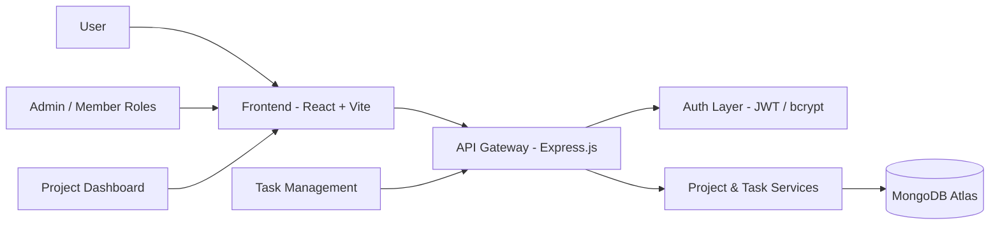

# Taskflow

<div align="center">
  
</div>

<p align="center">
  
  
  
  
  
  
</p>

<p align="center">
  <strong>Plan smarter. Assign clearly. Deliver faster.</strong>
</p>

<p align="center">
  <a href="https://task-flow-sh.netlify.app/" target="_blank"></a>
  <a href="https://task-flow-sh.up.railway.app/api/" target="_blank"></a>
  <a href="https://github.com/Abhishek2114/Taskflow/stargazers" target="_blank"></a>
</p>

Taskflow is a modern team productivity platform built for fast-moving teams that need structure without friction. It combines project planning, task ownership, dashboard visibility, and workflow execution in one streamlined system.

From product planning to execution, Taskflow helps teams stay aligned, reduce ambiguity, and move work forward with clarity.

## Why teams use Taskflow

- Organize work into structured projects
- Assign ownership with clear accountability
- Track progress in real time across teams
- Prioritize critical work using task states and urgency
- Keep execution visible through dashboards and analytics

## Product snapshot

<div align="center">
  
</div>

<p align="center">
  <em>Branding preview for Taskflow — designed for modern workflow products.</em>
</p>

## Core features

### Team workflow management

- Create and manage multiple projects
- Invite and assign teammates to each project
- Track responsibilities across every workstream
- Visualize progress from backlog to completion

### Task execution engine

- Create, edit, delete, and assign tasks
- Status tracking: TODO, IN_PROGRESS, DONE
- Prioritization: LOW, MEDIUM, HIGH
- Due date tracking and overdue monitoring
- Search, filtering, and project-specific task views

### Operational visibility

- Dashboard metrics for total tasks, completed work, pending work, and overdue tasks
- High-priority workload visibility
- Recent activity trends and project insights
- Real-time task health monitoring

### Product experience

- Kanban-style board by default
- Optional table view for workflows and reporting
- Dark mode and light mode support
- Responsive SaaS-inspired interface
- Loading states, empty states, and toast feedback

## Architecture overview



## Tech stack

### Frontend

- React
- Vite
- Tailwind CSS
- Axios
- React Router
- Lucide Icons

### Backend

- Node.js
- Express.js
- MongoDB + Mongoose
- JWT Authentication
- bcrypt
- dotenv
- cors

### Deployment

- Netlify for frontend hosting
- Railway for backend deployment
- MongoDB Atlas for persistent data storage

## Solution architecture

Taskflow follows a clean three-layer architecture designed for maintainability and product scalability:

1. Presentation Layer
   - React frontend for user interactions and workflow UI
   - Tailwind-based responsive design
   - Dashboard and task management views

2. Application Layer
   - Express API for business logic and routing
   - Auth middleware and access control
   - Project and task service processing

3. Data Layer
   - MongoDB schema-based models
   - Structured records for users, projects, and tasks
   - Secure and scalable persistence for long-term product use

## Platform highlights

<p align="center">
  
  
  
  
</p>

## Live app

- Frontend: https://task-flow-sh.netlify.app/
- Backend API: https://task-flow-sh.up.railway.app/api/

## Project structure

```bash
taskflow/
├── frontend/                 # React app
│   ├── src/
│   ├── public/
│   └── package.json
├── backend/                  # Express API
│   ├── src/
│   ├── routes/
│   ├── controllers/
│   ├── models/
│   └── package.json
├── taskflow-light.svg        # branding asset
├── taskflow-dark.svg         # dark branding asset
├── taskflow-favicon.png      # app icon
├── netlify.toml              # Netlify configuration
├── README.md
└── .gitignore
```

## Local setup

### 1. Clone the repository

```bash
git clone https://github.com/Abhishek2114/Taskflow.git
cd Taskflow
```

### 2. Install dependencies

```bash
cd backend
npm install

cd ../frontend
npm install
```

### 3. Run the backend

```bash
cd backend
npm run dev
```

Backend URL:

```text
http://localhost:5000/api
```

### 4. Run the frontend

```bash
cd frontend
npm run dev
```

Frontend URL:

```text
http://localhost:5173
```

## Environment variables

### Backend (.env)

```env
PORT=5000
MONGO_URI=your_mongodb_connection_string
JWT_SECRET=your_secret_key
CLIENT_URL=https://task-flow-sh.netlify.app
```

### Frontend (.env)

```env
VITE_API_URL=https://task-flow-sh.up.railway.app/api
```

## Seed demo data

```bash
cd backend
npm run seed
```

Creates:

- admin user
- member user
- sample project
- sample tasks

### Demo credentials

- Admin: `admin@admin.com` / `Admin@123`
- Member: `member@member.com` / `Member@123`

## API overview

### Authentication

- `POST /api/auth/signup`
- `POST /api/auth/login`
- `GET /api/auth/me`

### Users

- `GET /api/users/me`
- `PUT /api/users/profile`
- `PUT /api/users/change-password`

### Projects

- `GET /api/projects`
- `POST /api/projects`
- `GET /api/projects/:id`
- `POST /api/projects/:id/members`

### Tasks

- `GET /api/tasks`
- `POST /api/tasks`
- `PUT /api/tasks/:id`
- `DELETE /api/tasks/:id`

### Dashboard

- `GET /api/dashboard/stats`

## Product philosophy

Taskflow is built around a simple principle: teams should be able to plan, assign, and execute work without friction.

We focus on:

- simplicity over complexity
- clarity over clutter
- scalable architecture over short-term hacks
- product polish over generic dashboards
- real-world workflow design over demo-only features

## Built for momentum

Taskflow is designed for product teams, startups, and internal operations teams that want to move quickly without losing structure.

It brings together the essentials of modern collaboration tools while remaining lightweight enough to run and extend locally.

## Author

**abhisheksinghrajput2124@gmail.com**

- Email: [abhisheksinghrajput2124@gmail.com](mailto:abhisheksinghrajput2124@gmail.com)

## Support

If this project helped you or inspired your workflow, give it a star ⭐ and share it with your team.
